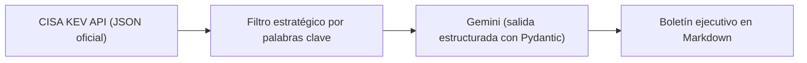

# GEO-CTI · Pipeline de Ciberinteligencia Estratégica con IA

Pipeline en Python que **descarga automáticamente el catálogo oficial de vulnerabilidades explotadas activamente (CISA KEV)**, selecciona la más relevante para infraestructuras críticas y defensa, y genera con **Google Gemini** un **boletín ejecutivo** con lectura técnica, geopolítica y normativa.

> Proyecto de portafolio que une ciberseguridad técnica (CompTIA Security+, MITRE ATT&CK), inteligencia de amenazas (CTI) y gobernanza (NIS2, ENS, NIST CSF).

---

## ¿Qué hace?



1. **Recolección**: descarga el feed público de [CISA Known Exploited Vulnerabilities](https://www.cisa.gov/known-exploited-vulnerabilities-catalog).
2. **Priorización determinista**: ordena por fecha y filtra activos estratégicos (VPN, firewalls, SCADA/ICS, Active Directory, Fortinet, Cisco, Ivanti...).
3. **Análisis con IA**: Gemini devuelve un JSON validado contra un esquema Pydantic (sin texto libre que haya que interpretar).
4. **Informe**: genera `Boletin_CTI_<CVE>.md` con:
   - Vector técnico (terminología Security+)
   - Mapeo MITRE ATT&CK
   - Lectura geopolítica e impacto en defensa
   - Impacto GRC (NIS2 / ENS / NIST CSF)
   - 3 cursos de acción para CISO y dirección

📄 **Ejemplo real generado:** [Boletin_CTI_CVE-2025-61624.md](Boletin_CTI_CVE-2025-61624.md)

---

## Stack

| Componente | Uso |
|---|---|
| Python 3.12 | Lenguaje principal |
| `requests` | Consumo de la API de CISA |
| `google-genai` | SDK oficial de Gemini |
| `pydantic` | Esquema y validación de la salida de la IA |
| `python-dotenv` | Gestión segura de secretos |

---

## Instalación

```powershell
git clone https://github.com/XabiCTY/GEO-CTI.git
cd GEO-CTI

python -m venv venv
# Windows:
venv\Scripts\activate
# Mac/Linux:
# source venv/bin/activate

pip install -r requirements.txt
```

### Configurar la clave de API

```powershell
copy .env.example .env      # Mac/Linux: cp .env.example .env
```

Edita `.env` y añade tu clave de [Google AI Studio](https://aistudio.google.com/apikey):

```env
GEMINI_API_KEY="tu_clave"
GEMINI_MODEL="gemini-3.8-flash"
```

---

## Uso

```powershell
python main.py
```

Salida esperada:

```text
[*] Descargando catálogo oficial CISA KEV...
[+] Vulnerabilidad detectada: CVE-2025-61624 (Fortinet Multiple Products)
[*] Ejecutando análisis táctico-estratégico con gemini-3.8-flash...
[OK] Informe generado en: Boletin_CTI_CVE-2025-61624.md
```

### Modo simulación (sin consumir API)

En [`main.py`](main.py) cambia `MOCK_MODE = True` para probar el pipeline completo sin clave ni coste.

---

## Seguridad

Aplicación práctica de buenas prácticas de **prevención de fuga de credenciales**:

- 🔐 La clave de API se carga desde `.env`, **nunca** se escribe en el código.
- 🚫 `.gitignore` excluye `.env`, `venv/`, certificados (`*.pem`, `*.key`) y carpetas de credenciales.
- 📋 `.env.example` documenta las variables necesarias sin exponer valores reales.
- ✅ El script valida que exista la clave y falla con un mensaje claro si no está configurada.
- 🧱 La salida de la IA se valida con Pydantic antes de escribirse en disco.
- 🌐 Solo se envían a Gemini **datos públicos** del catálogo de CISA.

---

## Aviso

Los informes son generados por IA a partir de datos públicos y tienen fines educativos y de apoyo a la decisión. Deben ser revisados por un analista antes de usarse en un entorno real.
